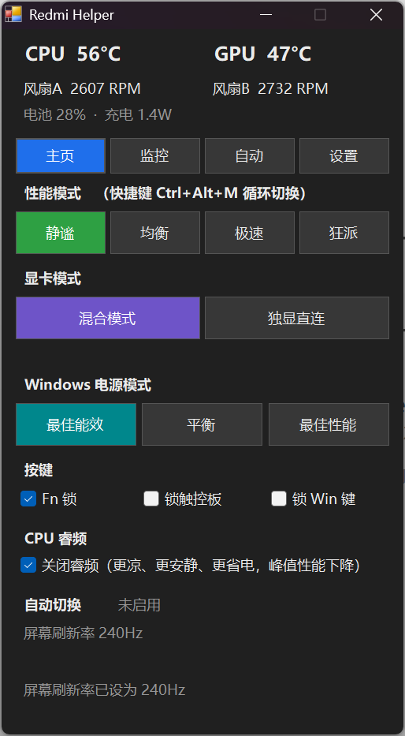
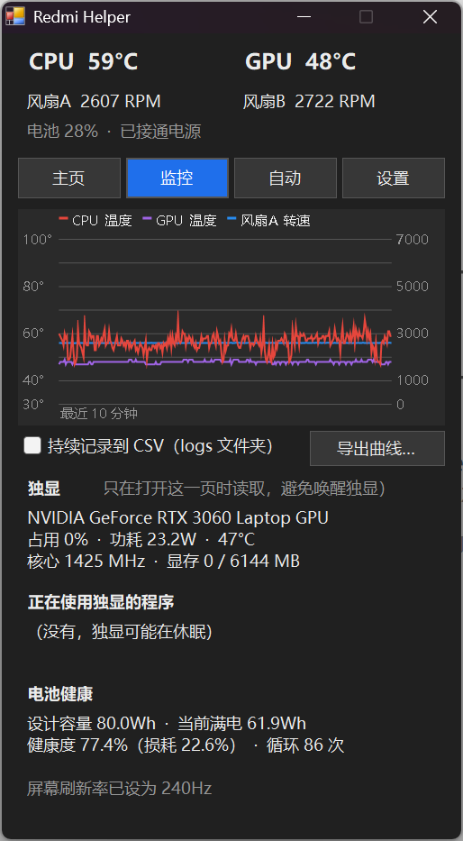

# Redmi Helper

[中文](README.md) | **English**

A lightweight control tool for the **Redmi G Pro 2022 (Intel / i7-12650H)**, in the spirit of [G-Helper](https://github.com/seerge/g-helper) for ASUS laptops: one small exe, no pile of background services, built to replace the bloated Xiaomi G Command Center.

> Not affiliated with Xiaomi. Use at your own risk.

  
  &nbsp;&nbsp;
  

The UI is available in Chinese and English (Settings → Language, or follows the Windows display language).

## Features

**Home**
- Four performance modes: Silent / Balanced / Turbo / Beast (`Ctrl+Alt+M` cycles through them)
- GPU mode: Hybrid / dGPU only (MUX switch, applies after restart; pending changes are remembered)
- Power plan (Control Panel → Power Options): Power saver / Balanced / High performance; plans hidden by Windows are restored automatically
- Fn lock, touchpad lock, Win key lock
- CPU turbo boost on/off (uses a built-in Windows power setting, no driver needed; 12th-gen H-series CPUs cannot be undervolted, so this is the alternative)
- Live CPU / GPU temperature, both fan speeds, battery draw and estimated runtime

**Monitor**
- 10-minute temperature and fan speed graph
- Continuous CSV logging, or export the current graph
- dGPU load, power, clocks, VRAM and the apps using it (via `nvidia-smi`, only read while this page is open so the dGPU isn't woken needlessly)
- Battery health: design capacity, full-charge capacity, wear, cycle count

**Auto**
- Smart mode: switches between two modes based on CPU load and temperature
- Schedule: e.g. Silent every day from 23:00 to 7:00 (wraps past midnight)
- Game list: switch to a chosen mode while a game runs, restore afterwards
- Silent on battery, power plan follows performance mode, max refresh rate plugged in / 60Hz on battery, turbo off in Silent mode or on battery
- Priority: games > schedule > smart. A manual switch pauses automation until something changes

**Other**
- Tray icon shows CPU temperature, colored by the current mode; click for a mini panel, double-click for the full window
- Light / dark theme (can follow Windows)
- Can take over the keyboard's Control Center key
- Start with Windows (Task Scheduler with admin rights, no UAC prompt)

## Download

Get the latest `RedmiHelper.exe` from [Releases](../../releases). It is not code-signed, so Windows SmartScreen may warn you: click "More info → Run anyway". It needs administrator rights.

## Build

No Visual Studio or .NET SDK needed. It compiles with the C# compiler that ships with Windows:

1. Download or clone this repository to a permanent folder
2. Double-click `build.bat`
3. When you see `BUILD OK`, run `RedmiHelper.exe` (as administrator)

## How it works

The BIOS exposes a WMI interface: `root\wmi` → `MICommonInterface` → method `MiInterface`. Input and output are 32-byte arrays:

| Byte | Meaning |
|---|---|
| `[1]` | `0xFA` read / `0xFB` write; `128` in the reply means success |
| `[3]` | Command ID |
| `[4]`, `[6]` | Arguments / return values |

Command table measured on this machine:

| Command | Function | Notes |
|---|---|---|
| 8 | Performance mode | Silent=2, Balanced=1, Turbo=3, Beast=4 |
| 9 | Sensors (read only) | `[4,5]` fan A, `[6,7]` fan B (little endian), `[10]` CPU temp, `[14]` GPU temp (cross-checked with nvidia-smi) |
| 10 | Key locks | `[4]` sub-ID: 0=touchpad, 1=Fn lock, 2=Win key; `[6]` value: 1=locked |
| 11 | GPU mode | 0=Hybrid, 1=dGPU only; applies after restart, reads return the mode currently in effect |

The interface comes from the ODM Bitland, and the Linux kernel has a driver for it ([bitland-mifs-wmi docs](https://kernelsources.org/source/xref/linux/Documentation/wmi/devices/bitland-mifs-wmi.rst)). Command IDs differ between models; the table above was measured on a Redmi G Pro 2022 and checked against how the official app calls the interface.

### Not possible on this machine

- **Custom fan curves**: the official app has no manual fan control, so the firmware most likely doesn't expose it
- **Battery charge limit**: same reason
- **Automatically powering off the dGPU on battery**: GPU switching here is a MUX switch and needs a restart
- **CPU undervolting**: Intel removed voltage control from 12th-gen and newer H-series mobile CPUs

## Other models

If your laptop also has `MICommonInterface` (run `Get-CimClass -Namespace root\wmi -ClassName MICommonInterface` in an admin PowerShell), parts of this tool may work, but the command IDs may differ. Test with read-only commands first. Issues reporting your model are welcome.

## License

MIT
