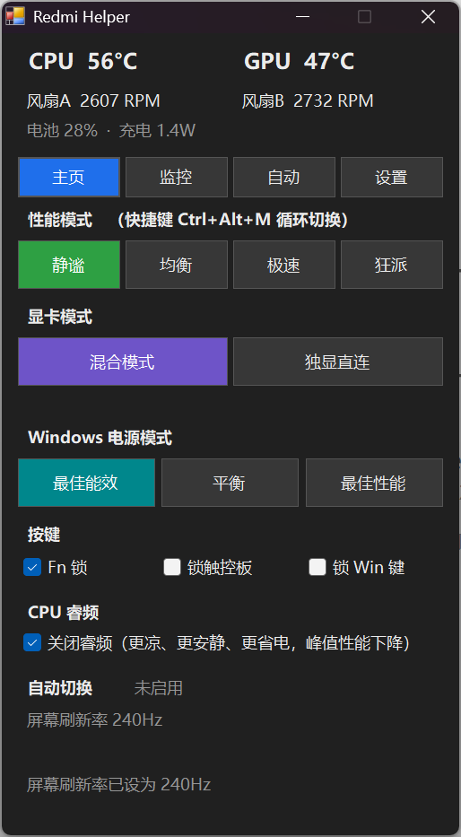
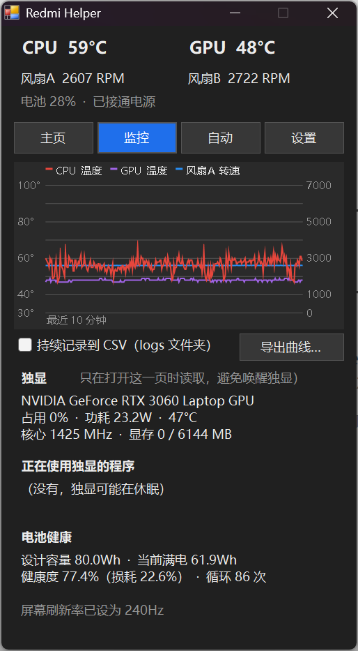

# Redmi Helper

**中文** | [English](README.en.md)

一个给 **Redmi G Pro 2022（Intel / i7-12650H）** 用的轻量控制工具，思路类似华硕笔记本上的 [G-Helper](https://github.com/seerge/g-helper)：单个 exe、不常驻一堆后台服务，用来替代臃肿的「小米游戏智控中心」。

> 本项目与小米公司无关。使用风险自负。

  
  &nbsp;&nbsp;
  

界面支持中文和英文（设置 → 语言，默认跟随 Windows 显示语言）。

## 功能

**主页**
- 四种性能模式一键切换：静谧 / 均衡 / 极速 / 狂派（快捷键 `Ctrl+Alt+M` 循环切换）
- 显卡模式：混合模式 / 独显直连（重启生效，会记住待生效的更改）
- 电源计划（控制面板 → 电源选项）：节能 / 平衡 / 高性能，系统隐藏了的计划会自动恢复
- Fn 锁、触控板锁、Win 键锁
- CPU 睿频开关（Windows 自带的电源设置，不需要驱动；12 代 H 系列 CPU 无法降压，这是替代方案）
- 实时 CPU / GPU 温度、两个风扇转速、电池功耗和剩余时间

**监控**
- 最近 10 分钟的温度和风扇转速曲线
- 持续记录到 CSV，或者一键导出当前曲线
- 独显占用率、功耗、频率、显存，以及正在使用独显的程序（通过 `nvidia-smi`，只在打开这一页时读取，避免无谓唤醒独显）
- 电池健康度：设计容量、当前满电容量、损耗、循环次数

**自动**
- 智能模式：根据 CPU 负载和温度在两个模式之间自动切换
- 定时规则：比如每天 23:00–7:00 自动切到静谧（支持跨午夜）
- 游戏列表：指定程序运行时自动切到某个模式，关闭后恢复
- 拔电自动静谧、电源计划跟随性能模式、插电 240Hz / 电池 60Hz、静谧或电池时自动关睿频
- 优先级：游戏 > 定时 > 智能；手动切换后自动切换会暂停，直到情况变化

**其他**
- 托盘图标显示 CPU 温度，颜色代表当前模式；左键弹出小窗，双击打开完整窗口
- 浅色 / 深色主题（可跟随系统）
- 可接管键盘上的「控制中心」键
- 开机自启（任务计划程序，带管理员权限、不弹 UAC）

## 下载

在 [Releases](../../releases) 下载最新的 `RedmiHelper.exe`。程序没有数字签名，Windows 可能弹出 SmartScreen 警告，点「更多信息 → 仍要运行」即可。需要管理员权限。

## 编译

不需要安装 Visual Studio 或 .NET SDK，用 Windows 自带的 C# 编译器即可：

1. 下载或 clone 本仓库到一个固定的文件夹
2. 双击 `build.bat`
3. 看到 `BUILD OK` 后运行 `RedmiHelper.exe`（需要管理员权限）

## 原理

笔记本 BIOS 提供了一个 WMI 接口 `root\wmi` → `MICommonInterface` → 方法 `MiInterface`，输入输出都是 32 字节的数组：

| 字节 | 含义 |
|---|---|
| `[1]` | `0xFA` 读取 / `0xFB` 写入；返回时 `128` 表示成功 |
| `[3]` | 命令号 |
| `[4]`、`[6]` | 参数 / 返回值 |

本机实测的命令表：

| 命令 | 功能 | 说明 |
|---|---|---|
| 8 | 性能模式 | 静谧=2，均衡=1，极速=3，狂派=4 |
| 9 | 传感器（只读） | `[4,5]` 风扇A，`[6,7]` 风扇B（小端），`[10]` CPU 温度，`[14]` GPU 温度（已与 nvidia-smi 读数核对） |
| 10 | 按键锁 | `[4]` 子号：0=触控板，1=Fn 锁，2=Win 键；`[6]` 值：1=锁定 |
| 11 | 显卡模式 | 0=混合，1=独显直连；写入后重启生效，读到的是当前实际生效的模式 |

这套接口来自代工厂 Bitland，Linux 内核里也有对应的驱动（[bitland-mifs-wmi 文档](https://kernelsources.org/source/xref/linux/Documentation/wmi/devices/bitland-mifs-wmi.rst)）。但不同机型的命令号不一样，上表是在 Redmi G Pro 2022 上实测、并与官方软件的调用方式对照确认过的。

### 做不到的功能

- **自定义风扇曲线**：官方软件里没有手动风扇控制，固件很可能没有开放这个接口
- **电池充电上限**：同上
- **拔电自动关闭独显**：这台机器的显卡切换是 MUX 切换，必须重启
- **CPU 降压**：Intel 从 12 代起移除了 H 系列移动处理器的电压控制

## 其他机型

如果你的电脑也有 `MICommonInterface`（在管理员 PowerShell 里运行 `Get-CimClass -Namespace root\wmi -ClassName MICommonInterface`），这个工具可能部分可用，但命令号可能不同，请先只用读取命令验证。欢迎提交 issue 反馈你的机型。

## 许可

MIT
